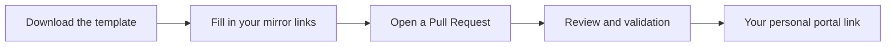

<div align="center">
  

  <h1>lunaPortal</h1>

  <p><strong>Mirror everything.</strong></p>

  <p>One personal portal for every project — collect your mirrors in one place and get a single, clean link.</p>

  <p>
    <a href="LICENSE"></a>
    <a href="../../pulls"></a>
    
  </p>
</div>

---

## What is lunaPortal?

**lunaPortal** is a community-curated index of mirrors. If your project lives in more
than one place — GitHub, GitLab, Codeberg, IPFS, a self-hosted instance — you no longer
need to paste five links into every post.

You submit your mirrors once. We review the request, accept it, and hand you back a
**personal portal link** that always points to the up-to-date list.

> **Mirror everything.**

---

## How it works



1. **Download** the request template: [`TEMPLATES/request.html`](TEMPLATES/request.html).
2. **Fill it in** with your project name, description and mirror links.
3. **Open a Pull Request** adding your filled template to the repository.
4. **We review** the request — license, project status, link availability.
5. **Get your link.** Once merged, your portal goes live at
   `https://portal.lunaoss.tech/cloud/<your-username>`.

---

## Submit your project

### Step by step

```bash
# 1. Fork the repository on GitHub, then:
git clone https://github.com/<your-username>/Portal.git
cd Portal

# 2. Create a branch
git checkout -b request/<your-username>

# 3. Copy the template and fill it in
cp TEMPLATES/request.html requests/<your-username>.html
$EDITOR requests/<your-username>.html

# 4. Commit and push
git add requests/<your-username>.html
git commit -m "request: add <project-name>"
git push origin request/<your-username>
```

Then open a Pull Request against `main`. The PR template will walk you through the checklist.

### What goes into the template

| Field         | Description                                                        |
| ------------- | ------------------------------------------------------------------ |
| `name`        | Project name as it should appear on the portal                     |
| `description` | One or two sentences, plain text                                    |
| `license`     | SPDX identifier of your project's license (must be OSI-approved)   |
| `links`       | One entry per mirror: label, URL, and optionally a region/note     |

---

## Requirements

To keep the index useful, every request must satisfy:

- ✅ **Open source only.** The project must be publicly available under an
  [OSI-approved license](https://opensource.org/licenses).
- ✅ **Publicly reachable links.** Every submitted mirror must load without login.
- ✅ **Your own project.** You are the maintainer, or you have permission to submit it.
- ✅ **One request per project.** Extra mirrors go into the same request file.
- ✅ **No malware, scams, NSFW or illegal content.**
- ✅ **Working links.** Mirrors are periodically re-checked; dead links are removed.

Requests that do not meet these requirements will be closed with an explanation —
you are always welcome to fix and reopen.

---

## Your personal link

Accepted requests are published at:

```
https://portal.lunaoss.tech/cloud/<your-github-username>
```

The page is rendered from the repository's HTML template
([`TEMPLATES/request.html`](TEMPLATES/request.html)), so the portal stays in sync
with what you submitted. Update your mirrors by opening a new Pull Request that
edits your request file.

---

## Repository layout

```
.
├── assets/
│   └── icon.svg              # Project logo
├── requests/                 # Submitted portal requests
│   └── <username>.html
├── TEMPLATES/
│   └── request.html          # The template you fill in
├── CONTRIBUTING.md
├── CODE_OF_CONDUCT.md
└── LICENSE                   # GPLv3
```

---

## Contributing

Contributions are what make lunaPortal useful. You can help by:

- Submitting your own project (see above),
- Reporting broken or outdated mirrors via an issue,
- Improving the HTML template or documentation,
- Reviewing open Pull Requests.

Please read [`CONTRIBUTING.md`](CONTRIBUTING.md) and
[`CODE_OF_CONDUCT.md`](CODE_OF_CONDUCT.md) before opening a Pull Request.
By participating, you agree to abide by the Code of Conduct.

---

## License

lunaPortal is licensed under the **GNU General Public License v3.0**.
See [`LICENSE`](LICENSE) for the full text.

Projects listed on lunaPortal keep their own licenses — the GPLv3 applies to this
repository, not to the projects it indexes.
