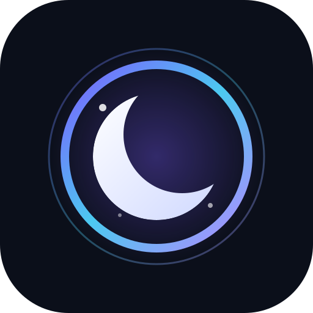

<div align="center">
  

  <h1>lunaPortal</h1>

  <p><strong>Mirror everything.</strong></p>

  <p>One personal portal for every project — collect your mirrors in one place and get a single, clean link.</p>

  <p>
    <a href="LICENSE"></a>
    <a href="../../pulls"></a>
    
  </p>
</div>

---

## What is lunaPortal?

**lunaPortal** is a community-curated index of mirrors with a monochrome frosted-glass aesthetic. If your open-source release lives in more than one place — **SourceForge, Google Drive (1–5), GitHub, Yandex Drive, Telegram, MEGA, MediaFire, OneDrive, or a Direct Link** — you no longer need to paste five links into every post.

You submit your mirrors once using our single-file HTML template. We review the request, accept it, and hand you back a **personal portal link** that always points to your up-to-date mirror list.

> **Mirror everything.**

## How it works

```
flowchart LR
  A[Download TEMPLATES/request.html] --> B[Fill in your mirror variables]
  B --> C[Open a Pull Request]
  C --> D[Review and validation]
  D --> E[Your personal portal link]

```

1. **Download** the request template: [`TEMPLATES/request.html`](TEMPLATES/request.html).

2. **Fill it in** by editing the JavaScript configuration variables at the top of the file (`ProjectName`, `Description`, `Version`, and your mirror URLs). Any field left as `"None"` is automatically hidden.

3. **Open a Pull Request** adding your filled file to `requests/<your-username>.html`.

4. **We review** the request — OSI-approved license, project status, and mirror reachability.

5. **Get your link.** Once merged, your portal goes live at:
   `https://portal.lunaoss.tech/cloud/<your-username>`

## Submit your project

### Step by step

```
# 1. Fork the repository on GitHub, then:
git clone https://github.com/<your-username>/Portal.git
cd Portal

# 2. Create a branch
git checkout -b request/<your-username>

# 3. Copy the template and fill in your variables
cp TEMPLATES/request.html requests/<your-username>.html
$EDITOR requests/<your-username>.html

# 4. Commit and push
git add requests/<your-username>.html
git commit -m "request: add <project-name>"
git push origin request/<your-username>

```

Then open a Pull Request against `main`. The PR template will walk you through the checklist.

### What goes into `TEMPLATES/request.html`

Inside the `<script>` configuration block at the top of the template, customize your portal by replacing `"None"` with your values:

| Variable | Description | Behavior when `"None"` | 
| ----- | ----- | ----- | 
| `ProjectName` | Project or release name (updates tab title & main heading) | **Required** (shows config warning if empty) | 
| `Description` | One or two sentences describing your project or file | Hidden automatically | 
| `Version` | Release version badge (e.g., `"v2.4.0-stable"`) | Hidden automatically | 
| `ReleaseDate` | Release date badge (e.g., `"2025-05-15"`) | Hidden automatically | 
| `FileSize` | File size badge (e.g., `"2.48 GB"`) | Hidden automatically | 
| `Maintainer` | Maintainer username or nickname (e.g., `"magic4n"`) | Hidden automatically | 
| `MD5_Checksum` / `SHA256_Checksum` | Optional file integrity hashes with one-click copy | Hidden automatically | 
| `SourceForge`, `YandexDrive`, `GoogleDrive_1`..`5`, `GitHub`, `Telegram`, `Mega`, `MediaFire`, `OneDrive`, `DirectLink` | Direct URLs to your mirrors (with instant URL copy & QR code modal) | Hidden automatically (at least 1 active mirror required) | 

## Requirements

To keep the index useful and trustworthy, every request must satisfy:

* ✅ **Open source only.** The project must be publicly available under an [OSI-approved license](https://opensource.org/licenses).

* ✅ **Publicly reachable links.** Every submitted mirror must load without login.

* ✅ **Your own project.** You are the maintainer, or you have permission to submit it.

* ✅ **One request per project.** Extra mirrors go into the same request file.

* ✅ **No malware, scams, NSFW or illegal content.**

* ✅ **Working links.** Mirrors are periodically re-checked; dead links are removed.

Requests that do not meet these requirements will be closed with an explanation — you are always welcome to fix and reopen.

## Your personal link

Accepted requests are published at:

```
https://portal.lunaoss.tech/cloud/<your-github-username>

```

The page is rendered directly from your submitted HTML template (`requests/<your-github-username>.html`), so your portal stays in sync with what you submitted. Update your mirrors anytime by opening a Pull Request that edits your file.

## Repository layout

```
.
├── index.html                # Official lunaPortal landing page
├── assets/
│   └── icon.svg              # Monochrome lunar portal logo
├── requests/                 # Submitted portal requests
│   └── <username>.html
├── TEMPLATES/
│   └── request.html          # The mirror hub template you fill in
├── CONTRIBUTING.md
├── CODE_OF_CONDUCT.md
├── README.md
└── LICENSE                   # GPLv3

```

## Contributing

Contributions are what make **lunaPortal** useful. You can help by:

* Submitting your own project (see above),

* Reporting broken or outdated mirrors via an issue,

* Improving the HTML template (`TEMPLATES/request.html`), homepage (`index.html`), or documentation,

* Reviewing open Pull Requests.

Please read [`CONTRIBUTING.md`](CONTRIBUTING.md) and [`CODE_OF_CONDUCT.md`](CODE_OF_CONDUCT.md) before opening a Pull Request. By participating, you agree to abide by the Code of Conduct.

## License

**lunaPortal** is licensed under the **GNU General Public License v3.0**. See [`LICENSE`](LICENSE) for the full text.

Projects listed on lunaPortal keep their own licenses — the GPLv3 applies to this repository, not to the projects it indexes.
